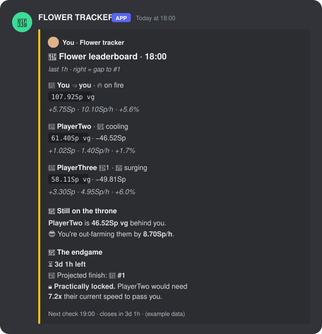
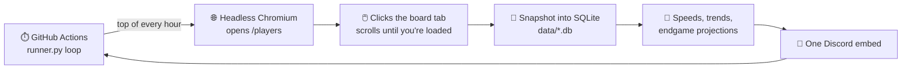

  

  <b>Every hour, on the hour, a race report for a <a href="https://petsuniverse.org/players">Pets Universe leaderboard</a> lands in Discord: who's farming, who's sleeping, and whether anyone can still catch you before the event ends.</b>

  
  
  
  
  

---

## 🏁 What it does

Leaderboard events are a marathon. Checking the board every hour from your phone gets old fast, so this does it for you.

- ⏰ Posts **one report every hour at :00** to a Discord channel
- 🥇 Top players + **you** + the players right above and below you, even if you're way outside the top 5
- 📈 Gain, **speed per hour** and % change for everyone, with mood tags: 🔥 on fire · 🚀 surging · 🧊 cooling · 😴 no gain
- 🔮 **Endgame maths**: projected finish place, and how much faster a rival would need to go to pass you (or you, to take #1)
- 🧾 Big numbers stay readable: `1.29e+26` becomes **`129.04Sp`** (K, M, B, T, Qa, Qi, Sx, Sp, Oc, No, Dc…)
- 🛑 Stops by itself when the event ends, with a final "tracker finished" message

## 📸 What a report looks like

  

## ⚙️ How it works

- **Honest by design**: if the site doesn't load, it retries twice (3 min apart). It only reports a failure after the 3rd try, and it never makes up numbers.
- A **wrong-board guard** makes sure it really read the board you asked for, not the default one.
- The job runs ~6 hours and then **starts its own next run**, so it keeps going for the whole event.

## 🔁 Track a different leaderboard

Everything board-specific lives in **one block** at the top of `.github/workflows/track.yml`:

| Setting | Example | Meaning |
|---|---|---|
| `TRACK_BOARD` | `Total Flowers` | the exact tab name on the players page |
| `TRACK_TITLE` | `Flower` | shown as "Flower leaderboard" |
| `TRACK_EMOJI` | `🌸` | emoji in the report title |
| `TRACK_MIN_EXP` | `20` | sanity check: the #1 value must be at least 10^20 |
| `TRACK_DB` | `data/tracker.db` | history file. **Use a new file for each board** |
| `TRACK_USER` | your Roblox name | the player to follow |
| `STOP_AT` | `2026-11-27T19:00:00+01:00` | when the event ends (sends a final message, then stops) |

## 🚀 Run your own

1. **Fork** this repo (keep it **public** for unlimited free Actions minutes).
2. Create a Discord webhook (*Channel settings → Integrations → Webhooks*).
3. Add the secret `DISCORD_WEBHOOK_URL` under *Settings → Secrets and variables → Actions*.
4. Edit the settings block above, then *Actions → tracker-runner → Run workflow*.
   Tick **preview** to get a report immediately.

## 📁 What's inside

| File | Job |
|---|---|
| `track.py` | reads the board, stores snapshots, works out speeds and the endgame, builds the report |
| `runner.py` | the long-running loop: hourly checks, retries, saving state, starting the next run |
| `.github/workflows/track.yml` | the workflow + **the leaderboard settings** |
| `data/*.db` | the leaderboard history (SQLite) |

---

Fan-made side project. Not affiliated with Pets Universe or Roblox. May contain traces of flowers. 🌸

