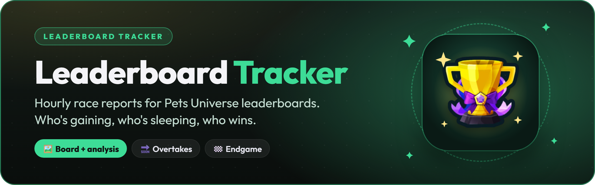
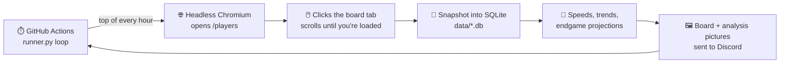

  

  <b>Every hour, on the hour, a race report for a <a href="https://petsuniverse.org/players">Pets Universe leaderboard</a> lands in Discord: who's farming, who's sleeping, and whether anyone can still catch you before the event ends.</b>

  
  
  
  
  

---

## 🆕 What's new

| Date | Update |
|---|---|
| **27 Nov 2026** | ⏱️ Clan War back to **every hour**: the site only updates war points about once an hour, so half-hour reports showed "no gain" |
| **27 Nov 2026** | 🎨 Each tracker has its own color, badge and header line, so the war and Thanksgiving posts are easy to tell apart (`TRACK_ACCENT`, `TRACK_LABEL`, `TRACK_HEADER`) |
| **27 Nov 2026** | 🦃 Also tracking **Thanksgiving Breakables** every hour, as a second tracker (`breakables.yml`). Below the top 50 it shows your place and what it takes to get in |
| **27 Nov 2026** | ⚔️ Now tracking **Clan War #3**, every **30 minutes**: your place even outside the top 100, plus your clan's place and points |
| **27 Nov 2026** | 🤖 **Want your own?** Send the repo link to any AI chatbot and ask it to set it up: there's now a step-by-step guide written for it |
| **26 Nov 2026** | 🔁 Discord posts are retried if Discord hiccups, with a text report as backup, so no hour is ever silently missing |
| **26 Nov 2026** | 🖼️ The hourly report is now **two pictures**: the board (top 5 + you, with Roblox avatars and speed bars) and a 12-hour analysis |
| **26 Nov 2026** | 🔟 Tracks the **top 15** every hour: overtakes coming, who enters or drops out of the top 10, and the projected final top 10 |
| **26 Nov 2026** | 📏 Every judgement uses each player's **12-hour average speed**, never a single hour, and never guesses when there's no history |

## 🏁 What it does

Leaderboard events are a marathon. Checking the board every hour from your phone gets old fast, so this does it for you.

- ⏰ Posts **one report every hour at :00** to a Discord channel, as two pictures
- 🥇 The **top 5** with their Roblox avatars, plus **you** if you're further down; the **top 15** are tracked behind the scenes
- 📈 Each player's **12h average speed** as a bar, with mood tags: 🔥 on fire · 🚀 surging · 🧊 cooling · 😴 no gain
- 🔜 **Overtakes coming**: who passes whom, and how soon
- 🔮 **Endgame maths**: the projected final top 10, where you finish, and ✅/❌ checks for catching #1, passing the player above and holding off the one below
- 🧾 Big numbers stay readable: `1.29e+26` becomes **`129.04Sp`** (K, M, B, T, Qa, Qi, Sx, Sp, Oc, No, Dc…)
- 🛑 Stops by itself when the event ends, with a final "tracker finished" message

## 📸 What a report looks like

Every hour, one Discord message with two pictures *(example data, made-up players)*:

<table>
<tr>
<td align="center" valign="top" width="50%"><b>1 · The board</b>  </td>
<td align="center" valign="top" width="50%"><b>2 · The analysis</b>  </td>
</tr>
</table>

- **The board:** rank badges, avatars, places moved in 12h (▲▼), the gap to #1 and a speed bar per player. Your own row is highlighted.
- **The analysis:** 🔜 overtakes coming · 🔮 the final top 10 if everyone keeps their pace · 📰 what changed in the last 12 hours · 🏁 your endgame.

If a picture ever can't be drawn, that hour's report is sent as text instead, so you never miss one.

## ⚙️ How it works

- **Honest by design**: if the site doesn't load, it retries twice (3 min apart). It only reports a failure after the 3rd try, and it never makes up numbers.
- A **wrong-board guard** makes sure it really read the board you asked for, not the default one.
- The job runs ~6 hours and then **starts its own next run**, so it keeps going for the whole event.

## 🔁 Track a different leaderboard

Everything board-specific lives in **one block** at the top of `.github/workflows/track.yml`:

| Setting | Example | Meaning |
|---|---|---|
| `TRACK_BOARD` | `Total Flowers` | the exact tab name on the players page |
| `TRACK_TITLE` | `Flower` | shown as "Flower leaderboard" |
| `TRACK_EMOJI` | `🌸` | emoji in the report title |
| `TRACK_MIN_EXP` | `20` | sanity check: the #1 value must be at least 10^20 |
| `TRACK_DB` | `data/tracker.db` | history file. **Use a new file for each board** |
| `TRACK_USER` | your Roblox name | the player to follow |
| `TRACK_SOURCE` | `war` | `war` = a Clan War board, read from the site's API (finds you even below #100, and shows your clan); `board` = a board from the site's API by `TRACK_BOARD_ID` (top 50, plus your place if you're below it); `page` = any other tab |
| `TRACK_BOARD_ID` | `TgBreakables` | only for `board`: the board's id in the site's API |
| `TRACK_ACCENT` | `#f59e0b` | color of the pictures and the Discord post (empty = green) |
| `TRACK_LABEL` | `🦃 THANKSGIVING` | badge in the corner of the pictures (empty = LEADERBOARD) |
| `TRACK_HEADER` | `🦃 **BREAKABLES** 🦃` | a line of text above each post (optional) |
| `TRACK_EVERY_MIN` | `30` | how often to report, in minutes (`60` = hourly) |
| `STOP_AT` | `2026-12-04T19:00:00+01:00` | when the event ends (sends a final message, then stops) |

## 🚀 Run your own

1. **Fork** this repo (keep it **public** for unlimited free Actions minutes).
2. Create a Discord webhook (*Channel settings → Integrations → Webhooks*).
3. Add the secret `DISCORD_WEBHOOK_URL` under *Settings → Secrets and variables → Actions*.
4. Edit the settings block above, then *Actions → tracker-runner → Run workflow*.
   Tick **preview** to get a report immediately.

## 📁 What's inside

| File | Job |
|---|---|
| `track.py` | reads the board, stores snapshots, works out speeds and the endgame, builds the report |
| `lbcard.py` | draws the two report pictures (board + analysis) |
| `runner.py` | the long-running loop: hourly checks, retries, saving state, starting the next run |
| `.github/workflows/track.yml` | the workflow + **the leaderboard settings** |
| `data/*.db` | the leaderboard history (SQLite) |

## 🤖 Want this for yourself? Ask an AI to set it up

You don't need to know how to code. Open any AI chatbot (ChatGPT, Claude, Gemini…), paste the link to this page and say:

> **"I want this set up for me. Please guide me step by step."**

The chatbot reads the guide below and walks you through it, one click at a time. It takes about 10 minutes, it's free, and you don't need a PC running: everything runs on GitHub.

### 📋 Setup guide for AI assistants

*This part is written for the AI chatbot helping someone set up their own copy. If you're a person, you can follow it too.*

**What this is:** a Pets Universe (Roblox) leaderboard tracker. At the top of every hour it reads one leaderboard on https://petsuniverse.org/players, saves it, and posts two pictures to Discord: the top 5 plus the user's own place, and an analysis of the top-10 race over the last 12 hours, ending with an endgame prediction. It runs for free on GitHub Actions in the user's own copy of this repo.

**Ask the user:**
1. **Which leaderboard:** the **exact tab name** on https://petsuniverse.org/players (letter for letter, e.g. `Total Flowers`). This becomes `TRACK_BOARD`.
2. **Their Roblox name** exactly as the board shows it. They need to be on that board. This becomes `TRACK_USER`.
3. **When the event ends** (date, time and their time zone), or "never" if the board doesn't end.
4. **A Discord channel** where the reports should go (they'll make a webhook for it).

**How to guide the user (they are usually not technical, often on a phone):**
- Go **one step at a time**. Give the exact button names and wait for them to confirm before moving on.
- Ask for the information in the "Ask the user" list first, then do the steps in order.
- **Never ask them to paste their Discord webhook URL into the chat.** It is a password: they paste it only into the GitHub secret box. If they already shared it somewhere public, have them delete the webhook and make a new one.
- They should **not edit any `.py` file**. Everything is set through secrets and the settings block in the workflow file.
- The repo must stay **public**. Public repos get unlimited free GitHub Actions minutes; this tracker runs 24/7 and would use up a private repo's free minutes in a couple of days. Secrets stay private in a public repo.

**Steps**
1. **GitHub account:** sign up free at https://github.com if they don't have one.
2. **Fork:** on this repo's page tap **Fork → Create fork**. Keep it public.
3. **Webhook:** create one in the chosen Discord channel (see below) and copy it.
4. **Secret** (see below): add `DISCORD_WEBHOOK_URL` = the webhook URL. That's the only secret needed. `HATCH_QUERY`, `FLOWER_WEBHOOK_URL` and `DISCORD_USER_ID` appear in the workflow but can be left out.
5. **Settings block:** edit `.github/workflows/track.yml`; everything is in the block at the top:

   | Setting | Set it to |
   |---|---|
   | `TRACK_BOARD` | the exact tab name from question 1 |
   | `TRACK_TITLE` | a short name for the title, e.g. `Coins` → "Coins leaderboard" |
   | `TRACK_EMOJI` | any emoji |
   | `TRACK_USER` | their Roblox name |
   | `TRACK_DB` | a **new** file name, e.g. `data/coins.db`. The existing `data/tracker.db` is the original owner's history, so never reuse it |
   | `STOP_AT` | the end time as `YYYY-MM-DDTHH:MM:SS+01:00`. The `+01:00` is the time zone offset: Stockholm in winter is `+01:00`, New York in winter is `-05:00`. Use `""` (empty) if the board never ends. **The value in the file is the original owner's event; change it. If it's in the past, the tracker stops at once.** |
   | `TRACK_SOURCE` | `"war"` for a Clan War board (the tab named "Clan War #…"), otherwise `"page"` |
| `TRACK_EVERY_MIN` | how often to report: `"60"` hourly, `"30"` every half hour |
| `TRACK_MIN_EXP` | a safety check that it read the right board: the #1 player's value must be at least 10 to this power. If unsure, set `"0"` to turn the check off |

**Enable and start it**
- In the fork, open the **Actions** tab. GitHub disables workflows in forks, so click **"I understand my workflows, go ahead and enable them"**.
- Then go to **Actions → tracker-runner → Run workflow** (on a phone, use "Desktop site" in the browser if the button is missing).
- After that it runs by itself: each run lasts about 6 hours and then starts the next one, and a backup timer restarts it if it ever stops. Nothing to keep open.

**What they should see**
- To test right away: **Run workflow** with **preview** ticked. A report appears in a few minutes.
- Then a report every hour at about :00 (**Stockholm time**). The first reports have less to say; speeds, the 12-hour analysis and the endgame fill in as history builds up.
- At `STOP_AT` it posts a final "tracker finished" message and stops. To track a new board later: edit the settings block again (new `TRACK_DB`, new `STOP_AT`) and run the workflow.

**If something's wrong**
- *"Tracker check FAILED … looks like the wrong board":* `TRACK_BOARD` doesn't match the tab name exactly, or `TRACK_MIN_EXP` is too high. Set it to `"0"`.
- *They aren't marked on the board:* check that `TRACK_USER` is spelled exactly as on the site.
- *Nothing at all:* open **Actions**, click the latest run, and read the error. Usually the secret name is misspelled, or `STOP_AT` is in the past.
- *Times are Stockholm time.* To change it, edit the line `TZ = ZoneInfo("Europe/Stockholm")` in every `.py` file that has it. That's the only code change worth making.

**Discord webhook (where the posts go)**
- Discord: right-click the channel (on a phone: long-press) → **Edit Channel → Integrations → Webhooks → New Webhook → Copy Webhook URL**. This needs "Manage Webhooks" permission on the server.
- Optional bot picture: in the same webhook screen, upload `assets/avatar.png` from this repo and give it a name.

**Adding a secret on GitHub**
- In the fork: **Settings → Secrets and variables → Actions → New repository secret**. The name must match exactly (capital letters, underscores).

**Editing the settings block**
- Open the workflow file on github.com, tap the **pencil icon**, change only the values between the quotes, then **Commit changes**.

---

Fan-made side project. Not affiliated with Pets Universe or Roblox. May contain traces of flowers. 🌸

